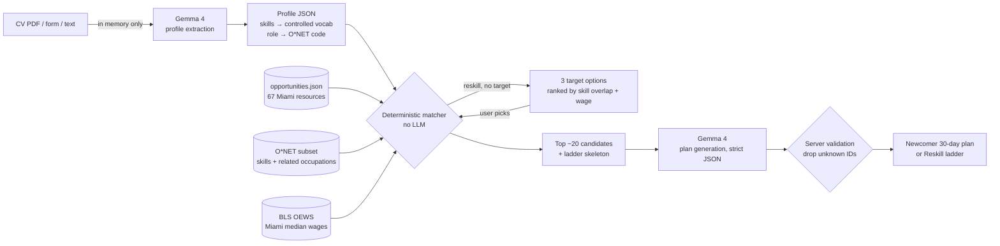

# 🌴 Miami City Brain

**Your next step in Miami, mapped to your goals.** An open-source AI guide that maps a person's background, goals and CV to real Miami opportunities. Newcomers get a first-30-days plan. Residents who want to change jobs get a reskilling ladder with Miami wages at every step. In English and Spanish.

> Built in one day at **Hack for Humanity Miami** (AI Collective × MLH), October 10, 2026.

| | |
|---|---|
| **Track** | **Track 03 — Brain Gain** (keep talent in Miami: career navigators, reskilling coaches, newcomer onboarding & network tools; access for non-English speakers and people without degrees) |
| **MLH challenges** | **Best Use of Gemma 4** · **Best Open-Source AI Project** |
| **Model** | **`gemma-4-26b-a4b-it`** (Gemma 4, open weights) via the **Gemini API** (`@google/genai`). Fallback after one retry: `gemma-4-31b-it` |
| **License** | MIT |

## The problem

Miami attracts talent but has trouble keeping it. Newcomers arrive with no local network and don't know where the builders, mentors or career services are. Long-time residents in hospitality, retail or logistics want better-paid, more stable work, but the reskilling landscape is fragmented: Miami Dade College certificates, CareerSource funding, M-DCPS technical colleges, library classes, bootcamps. And much of it is invisible to people who speak Spanish first or don't have a degree.

## What it does

**Two modes, chosen on the first screen:**

1. **✈️ "I'm new to Miami"** → a **week-by-week first-30-days plan** of communities, meetups, mentorship programs, career services and events. Each item says why it fits and gives a concrete next step. Also: career paths with Miami wages and a copy-ready intro message.
2. **🪜 "I live here and want to change jobs"** → a **career ladder**: **Now → Bridge → Target** with the BLS Miami median wage at each step. For each step: skills you already have (green), skills to build (amber), and 2–3 Miami options to close the gap, with cost, duration, schedule and a "no degree needed" badge. Plus **one thing to do this week** and communities to start a network in the new field. Don't know your target? It suggests 3, ranked by skill overlap, wage and education fit.

Also:
- **CV upload (PDF)** or short form or paste. *The CV is processed in memory and never stored.*
- **EN/ES** toggle for the UI and the generated plan.
- **"How this was made"** drawer showing the extracted profile JSON, the scored candidate list with match reasons, the ladder skeleton, the model name, timings, and any IDs the model invented that we dropped.
- **Print / save as PDF.**

## Where Gemma 4 is used (and where it isn't)

| Step | What | Where in code |
|---|---|---|
| 1. Profile extraction | **Gemma 4** turns CV/form text into structured JSON (role, O*NET code, skills mapped to a controlled vocabulary, constraints, language) | [`lib/pipeline/extract.ts`](lib/pipeline/extract.ts) → [`prompts/extract_profile.md`](prompts/extract_profile.md) |
| 2. Candidate retrieval | **Deterministic, no LLM.** Tag-overlap scoring (sector, language, budget, schedule, no-degree, goals). In reskill mode: O*NET transferable skills = current ∩ target, gaps = target − current, trainings whose `skills_taught` cover the gaps, ladder built over the O*NET related-occupations graph with BLS wages | [`lib/pipeline/retrieve.ts`](lib/pipeline/retrieve.ts) |
| 3. Plan generation | **Gemma 4** writes the plan in strict JSON and may **only** reference `opportunity_id`s from step 2. The server validates, drops anything else, and keeps roles, codes and wages from our data | [`lib/pipeline/plan.ts`](lib/pipeline/plan.ts) → [`prompts/plan_newcomer.md`](prompts/plan_newcomer.md), [`prompts/plan_reskill.md`](prompts/plan_reskill.md) |

All model calls go through one wrapper: [`lib/gemma.ts`](lib/gemma.ts). It uses `GoogleGenAI.models.generateContent` with `model: "gemma-4-26b-a4b-it"`, **JSON mode** (`responseMimeType: application/json`), **`thinkingLevel: MINIMAL`** (Gemma 4 "thinks" by default: about 60s per call on our prompts vs about 9s with minimal thinking, same output), a 75s timeout, 1 retry, then the `gemma-4-31b-it` fallback, plus a tolerant JSON parser and one "fix your JSON" retry.



## Open source: the Agent Skill

The matching logic ships as an **Agent Skill** following the Agent Skills standard: [`skills/miami-city-brain/SKILL.md`](skills/miami-city-brain/SKILL.md). Any agent can "match a profile to Miami opportunities and produce a 30-day newcomer plan or a reskilling ladder" using the **same data files and prompt templates** as the web app. The skill includes a deterministic matcher CLI that needs no API key:

```bash
npx tsx skills/miami-city-brain/scripts/match.ts --mode reskill --profile profile.json [--target 15-1232.00]
```

## Data sources

| Data | File | Source |
|---|---|---|
| Miami opportunities (67, curated) | [`data/opportunities.json`](data/opportunities.json) | Each organization's official website (`url` / `source_url` per record), checked on 2026-10-10 |
| Occupations, skills, related occupations (82) | [`data/onet_subset.csv`](data/onet_subset.csv) | Curated from **[O*NET OnLine](https://www.onetonline.org/)**. Skills simplified into our controlled vocabulary ([`lib/vocab.ts`](lib/vocab.ts)); this is a hand-built subset, not an official O*NET extract |
| Miami median wages | [`data/bls_miami_wages.csv`](data/bls_miami_wages.csv) | **[BLS Occupational Employment and Wage Statistics (OEWS)](https://www.bls.gov/oes/)**, May 2025, Miami–Fort Lauderdale–West Palm Beach, FL MSA (area 33100), annual + hourly median. Fetched from the BLS public API by [`scripts/fetch-bls.ts`](scripts/fetch-bls.ts) |
| Demo personas (3, fictional) | [`data/demo_personas/`](data/demo_personas/) | Written for the demo |
| Future | — | **[Miami-Dade County Open Data Hub](https://gis-mdc.opendata.arcgis.com/)** (e.g. library branches, transit, for "near you" suggestions) |

> This product includes information from O*NET OnLine by the U.S. Department of Labor, Employment and Training Administration (USDOL/ETA), used under the CC BY 4.0 license. USDOL/ETA has not approved, endorsed, or tested these modifications.

Notes on wages:
- **Web Developers (15-1254)** has no published Miami MSA estimate, so the app shows "n/a".
- In the ladder, the **"Now" step shows the person's own stated pay** when they provide it. Broad O*NET groups (e.g. "Office Supervisors", $67.5k) can overstate pay for specific jobs like hotel front-desk supervisor.

**Seeded organizations include:** The LAB Miami, Refresh Miami, eMerge Americas, The AI Collective Miami, Endeavor Miami, StartUP FIU, CIC Miami, Miami-Dade Beacon Council, Miami Dade College (EnTec, Medical Campus, workforce & continuing ed), CareerSource South Florida, Miami-Dade Public Library System, M-DCPS adult education & technical colleges, The English Center, FIU continuing education & SBDC, Prospera, Catalyst Miami, Florida Immigrant Coalition, SCORE, Google Career Certificates, Ironhack, 4Geeks Academy, trade apprenticeships, real-estate pre-licensing and more.

### ⚠️ Items that need verification

We didn't invent events, dates, prices, people or contact details. When we weren't sure, we left the field out and set `needs_verification: true` (shown as a "verify" badge in the UI):

| id | Why |
|---|---|
| `venture-cafe-miami` | Official site returned **HTTP 410 Gone**. Marked `inactive`, excluded from matching |
| `women-in-miami-tech` | No official site found; listing via Refresh Miami |
| `emerge-americas` | Site blocks automated checks (403); no dates listed on purpose |
| `code-for-miami` | Brigade activity status unclear |
| `cic-miami` | Site blocks automated checks (403) |
| `black-women-talk-tech` | National group; Miami presence unconfirmed |
| `himss-south-florida` | Chapter site blocks automated checks (403) |
| `score-miami-dade` | score.org 403; chapter page path unconfirmed |
| `church-world-service-miami` | Site 403; Miami office unconfirmed |
| `lutheran-services-florida` | Site 403; Miami services unconfirmed |
| `city-of-miami-business` | miami.gov blocks automated checks (403) |
| `lindsey-hopkins-technical-college` | Specific health programs not confirmed |
| `robert-morgan-technical-college` | HVAC/electrical/IT program list not confirmed |
| `george-t-baker-aviation` | Skills mapping approximate |
| `da-dorsey-technical-college` | Trade program list not confirmed |
| `miami-lakes-technical-college` | Trade program list not confirmed |
| `ibew-349-apprenticeship` | Apprenticeship page path not found |
| `ironhack` | Miami campus page redirects to remote programs |

Also missing from the data: no confirmed **CDL / truck-driving** program yet, and no dedicated Miami **health-tech** meetup.

## Run it locally

You need **Node.js 20+** and a **Gemini API key** ([get one free](https://aistudio.google.com/apikey)).

```bash
git clone <this repo> && cd miami-city-brain
npm install
cp .env.example .env.local   # then paste your key after GEMINI_API_KEY=
npm run dev                  # open http://localhost:3000
```

Other scripts:

```bash
npm run test:gemma       # one Gemma 4 call, to check your key
npm run test:personas    # runs all 3 demo personas end to end (extract → match → plan)
npx tsx scripts/fetch-bls.ts   # refresh Miami wages from the BLS API
```

Demo personas you've already run are cached in `.cache/` (git-ignored, model outputs only, never real CVs), so replays during a live demo are instant.

## Privacy

- CVs are parsed **in memory** (`unpdf`) and never written to disk or a database. There is no database and no auth.
- The extraction prompt tells the model to drop names, emails, phone numbers and addresses from the profile.
- The only cache stores outputs for the built-in **fictional** demo personas.
- Text goes to Google's Gemini API to run Gemma 4. Self-hosting the open-weight Gemma 4 model would remove that dependency (see roadmap).

## Roadmap

- Self-host Gemma 4 (open weights) for full data sovereignty for community organizations.
- Miami-Dade Open Data Hub: nearest library branch / career center by neighborhood and transit.
- Live event feeds (Luma/Meetup) for the newcomer plan; partner-verified program details, prices and start dates.
- More languages (Haitian Creole, Portuguese).

## Built with

- Next.js 15 (App Router) + TypeScript + Tailwind CSS 4
- `@google/genai` → Gemma 4 (`gemma-4-26b-a4b-it`)
- `unpdf` for PDF text extraction
- **AI tools used to build it:** Claude Code (Anthropic) as pair programmer: scaffolding, pipeline, UI, data curation and URL checks.

## Team

- _Name — role (add GitHub/LinkedIn)_
- _Name — role_
- _Name — role_

## License

[MIT](LICENSE)
